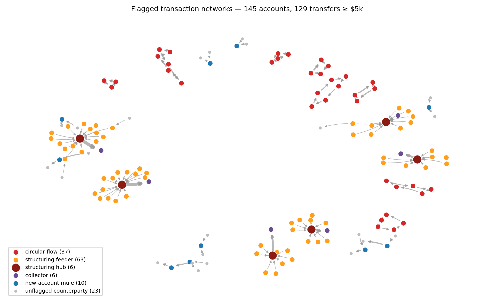

# Real-Time Fraud & AML Network Analyzer

A GPU-accelerated engine that finds organized **money laundering networks** (not just single bad transactions). It includes a natural-language analyst assistant that turns questions like:

> *"Synthesize suspicious transfer networks exceeding $10k routed through newly created accounts in the past 6 hours."*

into safe, read-only database queries, GPU graph analysis, and a structured, auditable fraud report.


<sub>Output of `make demo`: 145 accounts analyzed. Red = circular money loops (layering), orange/dark red = structuring hubs, purple = collectors, blue = new-account mules, grey = unflagged counterparties.</sub>

---

## What Problem Does This Solve?

Standard anti-money laundering (AML) software screens transactions one by one—like flagging a single transfer over $10,000. 

However, organized financial crime happens across **relationships between multiple accounts**:
- Bouncing money in loops across several new accounts to hide its origin.
- Breaking a large cash sum into dozens of deposits under $10,000 ("smurfing") into a central account.
- Passing victim funds through a brand-new "mule" account within minutes.

Checking these complex relationships across millions of transactions is slow on standard CPUs. This project uses **GPU graph processing** to trace these network patterns instantly.

---

## What It Detects (Fraud Typologies)

| Fraud Pattern | What Is Happening | How It Is Found |
|---|---|---|
| **Circular Flows (Layering)** | Money moves in a loop (e.g., Account A → B → C → A), where each step happens later in time and forwards most of the money. | Relational joins with strictly increasing timestamps to trace cycles. |
| **Structuring (Smurfing)** | 5+ senders move $9,000–$9,999 into one central account in a short window to avoid legal reporting limits. | Grouped aggregations counting unique counterparties per hub. |
| **New-Account Mules** | An account opened recently receives a large transfer and forwards 85%+ of the money within 2 hours. | Flow tracking comparing incoming vs. outgoing transaction times. |
| **Geographic Context** | Distance between senders and receivers across cross-border transfers. | Geographic coordinate joins using haversine distance. |

Every flagged account receives an **explainable risk score** where every point is tied to a specific human-readable reason (e.g., `+50: Part of a 4-hop circular loop`), rather than an opaque black-box AI score.

---

## System Architecture

```mermaid
flowchart LR
  Q["Analyst question<br/>(natural language)"] --> P["LLM Planner<br/>(NVIDIA NIM)"]
  P --> G{"SQL Guard<br/>Read-only SELECT check"}
  G -- Rejected / Invalid --> R["Rule-Based Planner<br/>(Deterministic Fallback)"]
  G -- Approved --> L[("PostgreSQL Ledger<br/>+ pgvector Notes")]
  R --> L
  L -- "Candidate Transfers" --> E["Graph Engine<br/>GPU (cuDF/cuGraph) or CPU (Pandas/NetworkX)"]
  E --> S["Explainable Risk Scores"]
  S --> V["pgvector Recall:<br/>Similar Past Cases"]
  S --> A["LLM Executive Summary<br/>(Uses exact numbers from engine)"]
  V --> O["Audit Report<br/>Markdown + JSON + SQL Trail"]
  A --> O